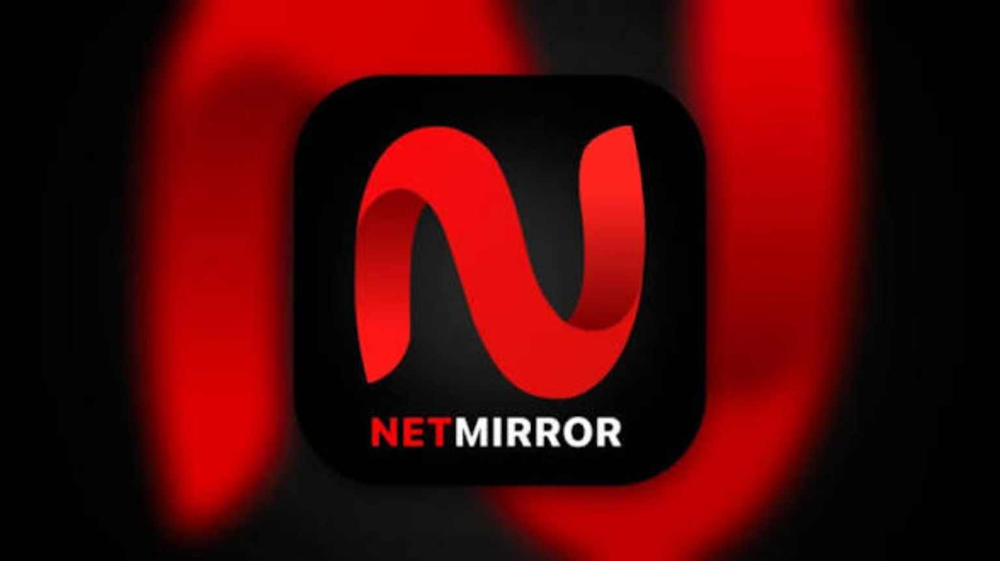
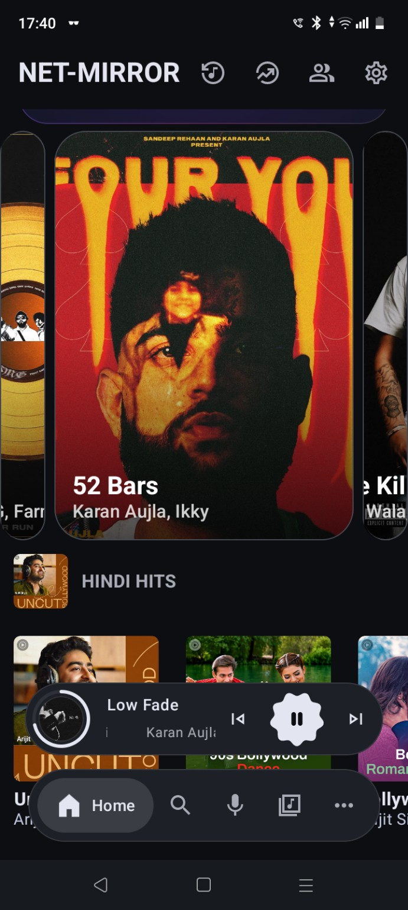
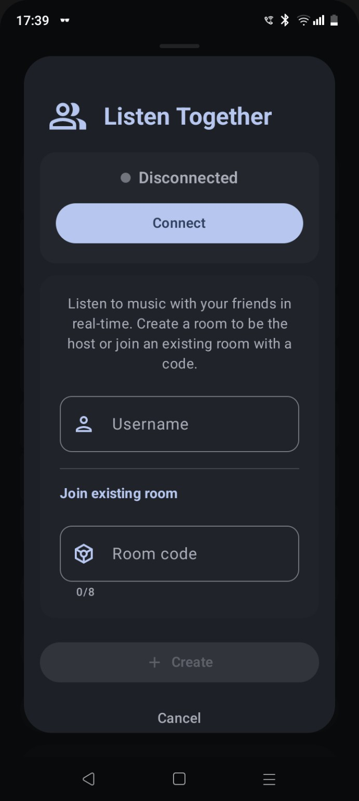

# NETMIRROR MUSIC

### Your music. Your mood. Your way.

**An ad-free music experience with high-quality listening, song downloads, pitch controls, and more.**

  
  
  

---

## 🎧 About NetMirror Music

**NetMirror Music** is a music app built for people who want a smooth, feature-rich listening experience. Enjoy music without ad interruptions, explore tracks, download supported songs, and personalize your listening with features such as pitch changing.

> **Made for music lovers.** Listen your way, customize your sound, and enjoy your music experience.

## ✨ Features

- 🚫 **Ad-free listening** — enjoy music without in-app ad interruptions.
- 🎵 **High-quality audio** — enjoy supported tracks in the available audio quality.
- ⬇️ **Song downloads** — download tracks where downloading is supported.
- 🎚️ **Pitch changer** — adjust the pitch to personalize the sound.
- 🤝 **Listen Together** — create a room or join a friend's room with a room code, where the feature is available.
- 🎼 **Music discovery** — browse music and discover tracks.
- ▶️ **Convenient playback controls** — manage playback from the player interface.
- 🌙 **Dark interface** — a modern, dark-themed design made for comfortable listening.
- ⚙️ **More controls and features** — explore the app to discover its additional tools.

*Feature availability can depend on the app version, device, region, and the music source.*

## 📱 Screenshots

### Home & Music Player

### Listen Together

### NetMirror Music Branding

## 🚀 Getting Started

1. Open this repository on GitHub.
2. Find the APK under **Releases** or the project's published download section, if one is available.
3. Download the APK to your Android device.
4. If Android asks, allow installation from that source in your device settings.
5. Install the app and open **NetMirror Music**.

**Safety tip:** Only install APK files from a source you trust. Android may display a warning when installing apps outside the Play Store.

## 📦 Downloads — Android Phone & Android TV

**Choose your device and download the APK:**

- 📱 **[Download Android Phone APK (Build 12)](https://github.com/kambojkartik37-developer/Net-Mirror_music/releases/download/netmirror-build-12/NetMirror-Music-Universal-FOSS-Debug.apk)** — universal FOSS debug build for Android phones.
- 📺 **[Download Android TV APK (ARM64)](https://github.com/kambojkartik37-developer/Net-Mirror_music/releases/download/android-tv-build-11/NetMirror-Music-Android-TV.apk)** — Android TV build from the published TV release.
- 🔗 **[View all releases](https://github.com/kambojkartik37-developer/Net-Mirror_music/releases)** — check for newer builds and release notes.

A newer combined Phone + TV main release is being prepared. These APKs are debug/testing builds, not production-signed releases; install only if you trust the source. Physical-device testing is not implied.

## 🛠️ Built With

NetMirror Music's exact technology stack depends on the source code and build configuration in this repository. See the project files and workflow definitions for implementation details.

## 🤝 Contributing

Suggestions and bug reports are welcome.

1. Open an issue describing the suggestion or problem.
2. Include your device model, Android version, app version, and steps to reproduce any bug.
3. If you submit code changes, explain what was changed and why.

Please do not include private information, account credentials, or copyrighted music files in issues or pull requests.

## ⚖️ Disclaimer

- NetMirror Music is presented as an independent project. Do not assume affiliation with any music streaming service, artist, label, or other brand unless explicitly stated by the project owner.
- Music availability, playback, and downloads may depend on third-party services and their terms.
- Users are responsible for ensuring that their use and downloads comply with applicable laws and the rights of copyright owners.
- App features and screenshots may change between versions.

## 💙 Support the Project

If you find NetMirror Music useful, consider starring ⭐ this repository and sharing constructive feedback.

---

**NETMIRROR MUSIC**  
*Press play. Find your vibe.*

